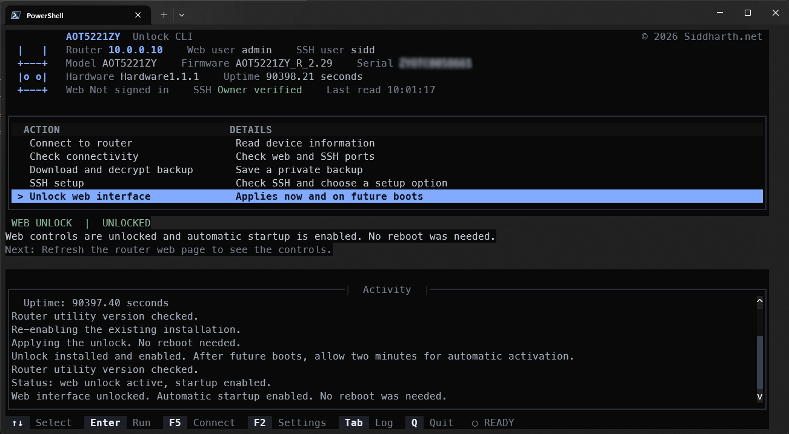
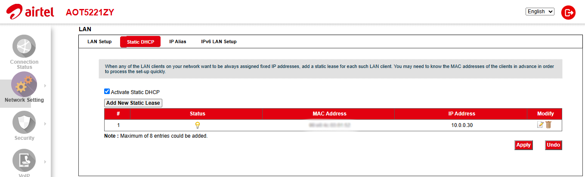
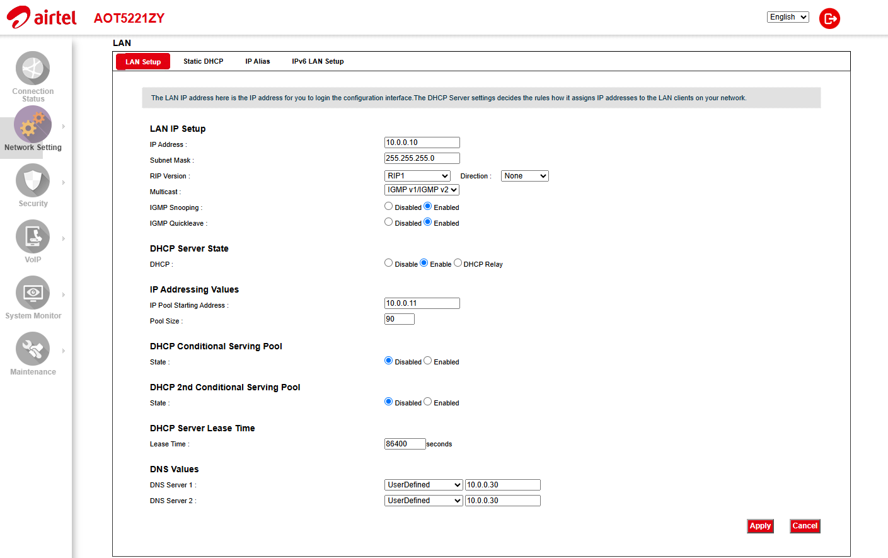
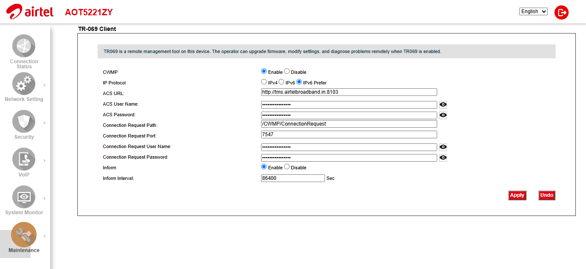

# Airtel AOT5221ZY Router Unlock Tool

A Python CLI for unlocking the web interface on the Airtel AOT5221ZY router. It also checks connectivity, downloads and decrypts configuration backups, and manages LAN SSH access. Tested on firmware **AOT5221ZY_R_2.29**.



## Run on Windows

Install Python 3.10 or newer. From the project folder, run:

```powershell
python -m venv .venv
.\.venv\Scripts\python.exe -m pip install -r requirements.txt
.\.venv\Scripts\python.exe router.py
```

Next time, run just the last line.

For the direct commands below, use `python` from the activated virtual environment or replace it with `.\.venv\Scripts\python.exe`.

Choose **Connect to router** to sign in. The header shows the model, firmware, uptime and serial number when available. Press **F5** to refresh or **F2** to edit the address and usernames. The CLI remembers your connection until you quit.

Use the arrow keys and **Enter** to choose an action, **Esc** to cancel a dialog, **Tab** to switch to the log and **Q** to quit.

## Download and decrypt

```powershell
python router.py download --host YOUR_ROUTER_IP --user YOUR_WEB_USERNAME
```

Saves `original.cfg` and `original.xml` in a new folder under `backups/`. Keep both files private. They can contain router passwords. Use `--output NEW_FOLDER` to choose another directory. Existing folders are not overwritten.

Thanks to **ankurpandeyvns** for documenting the [AOT5221ZY backup encryption format](https://gist.github.com/ankurpandeyvns/0f72eb73f5724f83b9ceebe079162505).

## Enable SSH

```powershell
python router.py enable-ssh --host YOUR_ROUTER_IP --user YOUR_WEB_USERNAME
```

If port 22 already serves SSH, it stops without changing anything. Otherwise it downloads a fresh backup and prepares the tested LAN SSH fields. It asks you to type **REBOOT** before restoring the configuration. **Restoring restarts the router and interrupts internet/Wi-Fi.** Your original backup is kept.

To prepare files without uploading or rebooting:

```powershell
python router.py enable-ssh --host YOUR_ROUTER_IP --user YOUR_WEB_USERNAME --prepare-only
```

The tested XML workaround requests Port=2222, but the router's actual SSH service uses **22**. It does not create an account or grant root privileges. After the router returns, use an existing root-capable owner account for unlocking.

## Unlock the web interface

```powershell
python router.py unlock --host YOUR_ROUTER_IP --user YOUR_OWNER_SSH_USERNAME
```

Type **UNLOCK** to proceed. If the SSH key is new or has changed, check the fingerprint before typing **TRUST**. Keys are stored locally under `%LOCALAPPDATA%/AOT5221ZYUnlockCLI/ssh_known_hosts` on Windows, or `~/.local/share/AOT5221ZYUnlockCLI/ssh_known_hosts` elsewhere. No router key is preapproved.

The tool uses your SSH login to turn on the router's web debug flag. The change takes effect immediately without a reboot. It installs two scripts on the router:

- `/etc/router-web-unlock/apply.sh` applies the flag.
- `/etc/init.d/zzzz_router_web_unlock` runs the first script about two minutes after boot.

The installer also creates a startup link at `/etc/rc.d/S99zzzz_router_web_unlock`. A factory reset can remove these files and change the SSH key.

### Successful unlock

After unlocking, the CLI confirms that the web interface is unlocked and automatic startup is enabled. No reboot is required, as shown in the screenshot at the top of this page.

### Unlocked router settings

Once unlocked, the router's web interface exposes additional settings, such as the pages below.

**Static DHCP**

The router's **LAN > Static DHCP** page shows **Add New Static Lease** and **Apply**.



**LAN Setup**



**TR-069 Client**



## License

© 2026 [Siddharth.net](https://siddharth.net)

Original project code is licensed under the [MIT License](LICENSE). Third-party code retains its own license terms.

## Disclaimer

This tool changes settings on your router and can restore configuration backups. Use it at your own risk.

- **Tested only on the Airtel AOT5221ZY** (firmware: `AOT5221ZY_R_2.29`). Other models or firmware versions may behave differently or not work at all.
- A wrong or interrupted change can lock you out of the router's web interface or require a factory reset.
- Take a backup first and keep the backup files private. They can contain router passwords.
- This project is not affiliated with or endorsed by Airtel or the router's manufacturer. Check your ISP's terms before modifying the device.
- Provided as is, without warranty. See [LICENSE](LICENSE).
